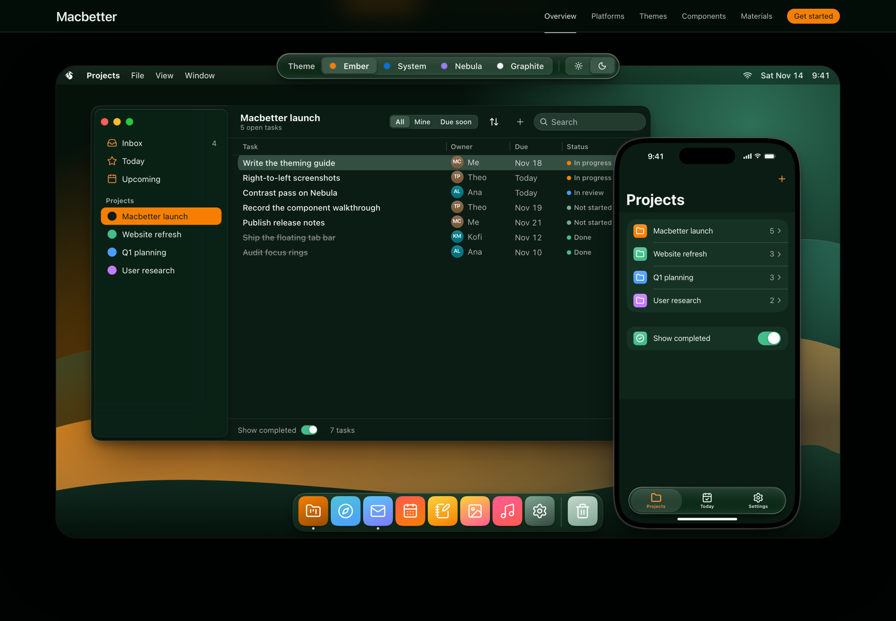
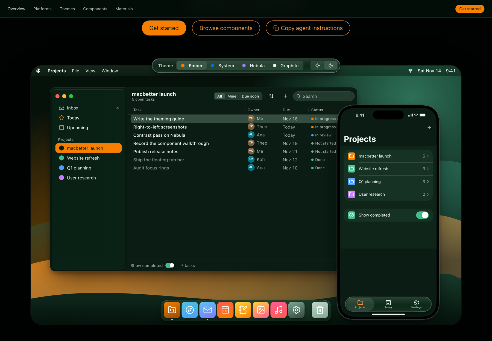
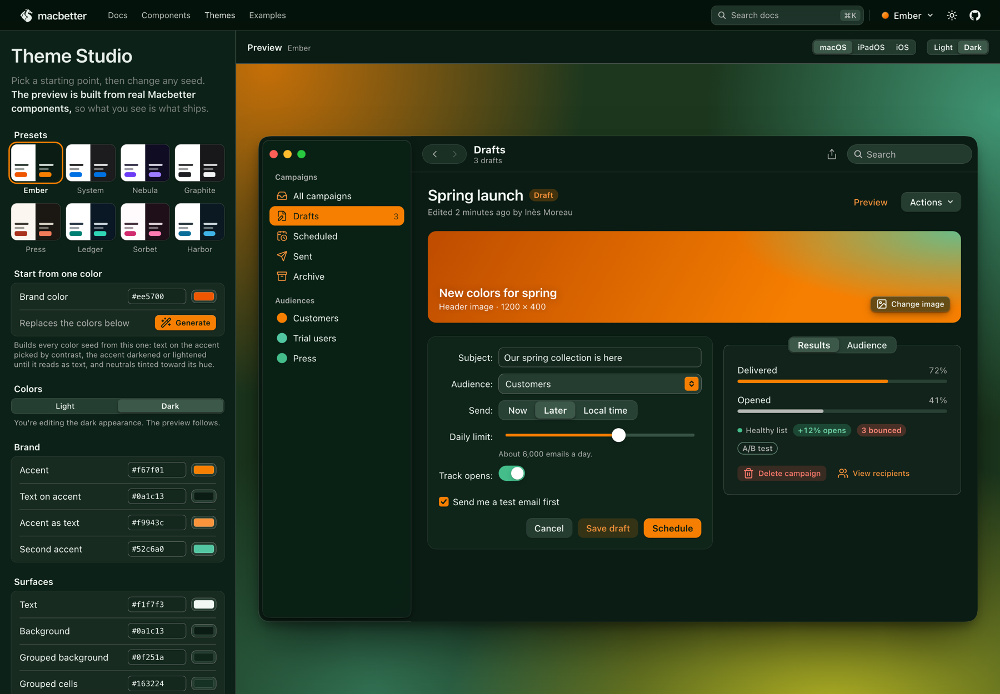
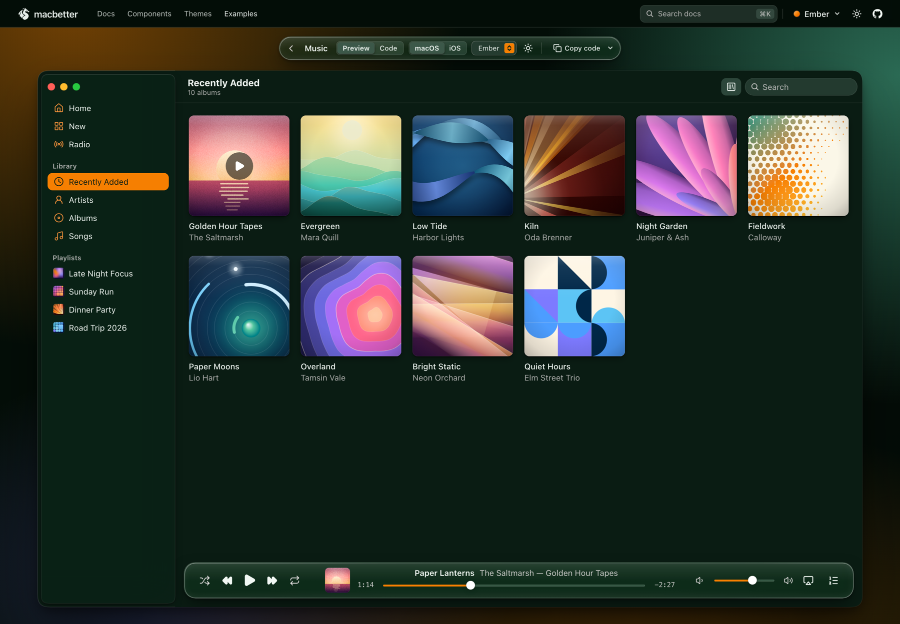

<p align="center">
  <a href="https://macbetter.dev">
    
  </a>
</p>

<h1 align="center">macbetter</h1>

<p align="center">
  macOS, iPadOS and iOS. One web framework.<br />
  Apple-style components for React, themeable to any brand, built on <a href="https://ui-sdk.dev">ui-sdk</a>.
</p>

<p align="center">
  <a href="https://macbetter.dev">Website</a> ·
  <a href="https://macbetter.dev/docs/introduction">Docs</a> ·
  <a href="https://macbetter.dev/docs/components">Components</a> ·
  <a href="https://macbetter.dev/themes">Theme Studio</a> ·
  <a href="https://macbetter.dev/examples">Examples</a>
</p>

---

macbetter is a design system that follows Apple's Human Interface Guidelines on the web. The same components render as a Mac app, an iPad app or an iPhone app, depending on one attribute. A short list of color and shape tokens re-skins all of it for your brand, in light and dark. Keyboard handling, focus, ARIA and right-to-left support come from [ui-sdk](https://github.com/vercel-labs/ui), so the components are also readable and operable by AI agents.

It is a personal open-source project by [Kyle Ledbetter](https://github.com/kyleledbetter). It is not affiliated with Apple.

## What's in it

- **93 components.** Buttons and controls, text fields, menus and pickers, alerts, sheets and popovers, app chrome (window, sidebar, toolbar, navigation bar, tab bar, dock, iPhone and iPad frames), lists and tables, status indicators, glass materials, generated artwork and a squircle primitive.
- **Three platforms.** `data-platform="macos" | "ipados" | "ios"` switches text sizes, control heights, hit targets and idioms: hover states and compact menus on the Mac; 44pt targets, capsule controls and bottom sheets on touch. It can be nested, so an iPhone preview can live inside a Mac page.
- **Themes from a few seeds.** Set an accent, an ink color, backgrounds, a tint gray, a radius scale and fonts. Labels, fills, separators, materials, shadows and every component state derive from them. Four themes are built in: Ember (the default), System, Nebula and Graphite.
- **Continuous corners.** Cards, windows, sheets, menus, app icons and the Dock use Apple's squircle curve through CSS `corner-shape`, measured against the real shape. Browsers without it get normal rounded corners.
- **Materials and motion.** Translucent materials and Liquid Glass with `backdrop-filter`, and spring curves as CSS `linear()` tokens. Both follow Reduce Transparency, Reduce Motion and Increase Contrast.
- **Home.** Fifteen components for home apps, modeled on Apple's Home app and the HomeKit guidelines: accessory and scene tiles, the tall level slider, a thermostat dial, lock and door controls, camera views, sensor readouts and a setup-code flow. They are UI only; a web page can't talk to HomeKit, and Apple's licensed HomeKit marks aren't included.
- **AI and chat.** Thirteen components for assistants: a thread that follows a streaming reply, messages, a prompt field with attachments and a model picker, reasoning, tool calls, plans, confirmations, sources and citations, artifact cards and generated images. They are UI only and take messages and state as props. In the docs, replies render Markdown with [Streamdown](https://streamdown.ai) in `apps/docs/src/components/ai/markdown.tsx`; the package itself has no Markdown or highlighter dependency.
- **Charts.** Stocks, Health and Fitness style charts on ECharts and [EvilCharts](https://evilcharts.com), themed from the same tokens. These live in the docs app and use those libraries; the package itself has no chart dependency.

<p align="center">
  
</p>

## Quick start

```bash
pnpm add macbetter @ui-sdk/react @ui-sdk/core
```

Import the stylesheet once. Everything sits in the `macbetter` cascade layer, so your own CSS wins without `!important`.

```css
/* globals.css */
@layer ui-sdk, macbetter;
@import "macbetter/styles.css";
```

Set the platform before first paint and pick a theme.

```tsx
// app/layout.tsx
import { MacbetterScript } from "macbetter"

export default function RootLayout({ children }: { children: React.ReactNode }) {
  return (
    <html lang="en" data-theme="ember" suppressHydrationWarning>
      <body data-macbetter="">
        <MacbetterScript />
        {children}
      </body>
    </html>
  )
}
```

Use a component. Each one has its own entry.

```tsx
import { Button } from "macbetter/button"
import { Switch } from "macbetter/switch"

<Button variant="filled">Save</Button>
<Switch aria-label="Wi-Fi" defaultChecked />
```

React 19 or newer is required. The package is compiled JavaScript with type declarations, so it needs no bundler configuration. The [installation guide](https://macbetter.dev/docs/installation) covers Tailwind CSS v4 layer order and the rest.

## Theme it

A theme is one CSS rule. Write the seeds you want to change and leave the rest.

```css
[data-theme="acme"] {
  --mb-accent: light-dark(#6d3df5, #9b7bff);
  --mb-on-accent: light-dark(#ffffff, #120a2e);
  --mb-ink: light-dark(#14102b, #f3f1ff);
  --mb-bg: light-dark(#ffffff, #100c24);
  --mb-radius-scale: 1.15;
}
```

Or generate a whole theme from one brand color:

```ts
import { deriveFromAccent } from "macbetter/derive"
import { createTheme } from "macbetter/theme"
```

The [Theme Studio](https://macbetter.dev/themes) does this in the browser, checks contrast as you edit, and exports the CSS.

<p align="center">
  
</p>

## Examples

Six full apps, each with a Mac and an iPhone version and a code view you can copy from: [Settings](https://macbetter.dev/examples/settings), [Mail](https://macbetter.dev/examples/mail), [Analytics](https://macbetter.dev/examples/analytics), [Music](https://macbetter.dev/examples/music), [Home](https://macbetter.dev/examples/home) and [AI Assistant](https://macbetter.dev/examples/assistant).

<p align="center">
  
</p>

## Repository layout

```
packages/macbetter/        the npm package
  src/components/          one file per component
  src/styles/              tokens, platforms, base, materials, themes, component CSS
  src/lib/                 cx, platform script, theme and color helpers
  test/                    vitest + jsdom
apps/docs/                 macbetter.dev (Next.js 16, MDX, Tailwind CSS v4)
  src/content/docs/        pages; the route is the file path
  src/demos/               live examples shown on the pages
  src/components/charts/   the chart kit (ECharts, EvilCharts)
  src/components/ai/       the Markdown renderer for assistant replies (Streamdown)
scripts/                   real-browser screenshot and route checks
AGENTS.md                  the working agreement for people and coding agents
```

## Develop

Run from the repository root with pnpm 10.

| Command | What it does |
| --- | --- |
| `pnpm install` | Install dependencies |
| `pnpm dev` | Start the docs site |
| `pnpm build` | Build the docs site for production |
| `pnpm typecheck` | Types in the package and the docs site |
| `pnpm test` | Component tests |
| `pnpm --filter macbetter build` | Compile the package to `packages/macbetter/dist`, as it is published to npm |
| `pnpm lint` | ESLint on the docs site |
| `node scripts/sweep.mjs` | Every route in a real browser, on desktop and phone and by in-app navigation: console errors, failed requests, sideways scrolling. Needs the site running on port 4173 (`pnpm --filter docs exec next dev -p 4173`). |
| `node scripts/shot.mjs <path> <out.png>` | A screenshot of one page. Flags are listed at the top of the file. |

Browser scripts share a two-browser limit (`scripts/browser-lock.mjs`), so several can run without stalling the machine.

To deploy the site, import the repository into Vercel and set the root directory to `apps/docs`.

## Status

macbetter is new and built on a beta of ui-sdk, so expect changes.

- It has been checked in Chromium only. Safari, Firefox, real iOS devices and screen readers are not tested yet.
- Alerts and sheets follow iOS 18 geometry rather than iOS 26's floating sheets.
- Pass a `render` element (`render={<Link href="/" />}`) from a client component. One created in a Server Component can reach ui-sdk before React has resolved it, which throws "Element type is invalid". The same goes for components that read their children, like Outline.
- The Outline page occasionally logs a React hydration warning in development: ui-sdk's Tree (0.1.0-beta.1) can compute a nested item's level one too low on the client. Nothing looks wrong on screen.
- ui-sdk writes shortcut modifiers as ⌘⇧P where macOS writes ⇧⌘P.
- Changing `dir` after the page has loaded leaves sliding indicators where they were until the next resize.

## Contributing

Issues and pull requests are welcome. Read [AGENTS.md](AGENTS.md) first: it has the component, CSS and docs conventions, and it works as a brief for a coding agent too.

## License

[Apache 2.0](LICENSE) © Kyle Ledbetter. The chart components under `apps/docs/src/components/charts/evil` are from EvilCharts and keep their MIT license.

Apple, macOS, iPadOS and iOS are trademarks of Apple Inc. macbetter is an independent project and is not endorsed by Apple.
